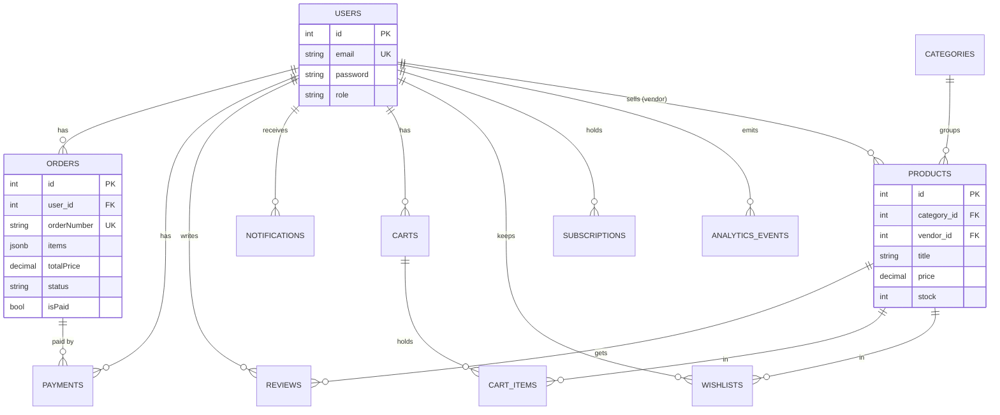

# LumicorePro — Database Relationships & Indexing Guide (ERD)

Diagrams the Sequelize models in `backend/models/` and the SQL schemas in
`database/schemas/`. Every foreign key below has an associated supporting index
(see `database/schemas/indexes.sql`) so joins don't degrade with table growth.

## Entity-Relationship (mermaid)

## Foreign-key → index coverage matrix

| FK column | Target table | Supporting index |
|---|---|---|
| `orders.user_id` | users | `idx_orders_user_status_created`, `idx_orders_user_created` |
| `orders.user_id + status + created_at` | — | `idx_orders_user_status_created` (composite) |
| `orders.is_paid + created_at` | — | `idx_orders_paid_created` (composite) |
| `payments.user_id` | users | `idx_payments_user_created` |
| `payments.order_id` | orders | PK on orders; webhook lookups via `idx_payments_stripe_intent` |
| `payments.status` | — | `idx_payments_status` |
| `products.category_id` | categories | category PK + `idx_products_category_active_price` |
| `products.vendor_id` | users | `idx_products_vendor` |
| `reviews.product_id` | products | `idx_reviews_product_created` |
| `reviews.user_id + product_id` | — | `idx_reviews_user_product` (unique review guard) |
| `notifications.recipient_id` | users | `idx_notifications_recipient_created` |
| `cart_items.cart_id` | carts | `idx_cart_items_cart` |
| `cart_items.product_id` | products | `idx_cart_items_product` |
| `wishlists.user_id` | users | `idx_wishlists_user` |
| `analytics_events.user_id` | users | `idx_analytics_user_event` |

## Composite-index rationale (high-traffic queries)

- **`orders(user_id, status, created_at DESC)`** — admin "orders by status, newest
  first" dashboard list; one index serves the full combo.
- **`orders(is_paid, created_at)`** — revenue rollups (`SUM(total_price) WHERE is_paid`)
  walk only committed rows.
- **`products(category, is_active, price)`** — storefront category filters sorted by
  price (price-asc/desc) with only active stock.
- **`products(is_active, rating DESC)`** — featured/"top rated" landing queries.

## Migration / drift control

- SQL source of truth: `database/schemas/*.sql` (users, ecommerce, electronics, saas).
- `backend/models/*` define Sequelize models; `models/index.js` wires associations.
- Run `database/schemas/indexes.sql` after schema migrations — all statements are
  `IF NOT EXISTS` (idempotent) and safe to re-run.
- Slow queries (>200 ms) are logged automatically by `backend/config/database.js` —
  watch `logs/combined.log` for `SLOW QUERY` lines to spot missing-index candidates.